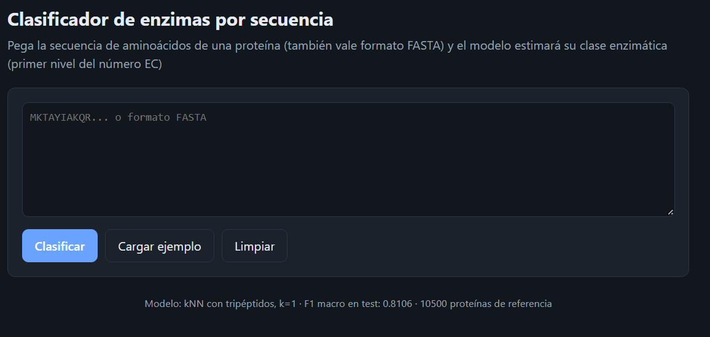

<div align="center">

# Clasificador de Enzimas por Secuencia

### Pega la secuencia de una proteína y descubre a qué familia de enzimas pertenece

[](https://www.python.org/)
[](https://scikit-learn.org/)
[](https://fastapi.tiangolo.com/)
[](https://www.uniprot.org/)
[](LICENSE)

</div>

---



## Qué hace

Las enzimas son proteínas que aceleran reacciones químicas dentro de los seres vivos, y se agrupan en **7 grandes familias** según el tipo de reacción que catalizan. Este proyecto entrena un modelo que **adivina a qué familia pertenece una proteína solo mirando su secuencia de aminoácidos**, sin ninguna otra información.

| Clase | Qué hacen |
|---|---|
| 1 · Oxidorreductasas | Reacciones de oxidación y reducción |
| 2 · Transferasas | Mueven un grupo químico de una molécula a otra |
| 3 · Hidrolasas | Rompen enlaces añadiendo agua |
| 4 · Liasas | Rompen enlaces sin agua ni oxidación |
| 5 · Isomerasas | Reorganizan una molécula en otra forma |
| 6 · Ligasas | Unen dos moléculas gastando energía |
| 7 · Translocasas | Mueven moléculas a través de membranas |


## Cómo lo hace

1. Convierte la secuencia en una especie de "huella dactilar": cuenta con qué frecuencia aparece cada combinación de 3 aminoácidos seguidos.
2. Busca, entre miles de proteínas conocidas, la que tenga una huella más parecida.
3. Le asigna la misma clase que esa proteína más parecida.
4. Enseña esa proteína "gemela" y otras 4 similares, con enlace directo a su ficha en UniProt, la gran base de datos de proteínas.

Es la misma lógica que un buscador de imágenes inverso: no "entiende" la proteína, encuentra la más parecida en una base de datos de referencia.

## Cómo usarlo

### 1. Descarga el proyecto e instala lo necesario

```
git clone https://github.com/Motama14/<nombre-del-repo>.git
cd <nombre-del-repo>
pip install -r requirements.txt
```

### 2. Arranca la aplicación

```
python -m uvicorn app.main:app --reload
```

### 3. Ábrela en el navegador

**http://127.0.0.1:8000**

### 4. Pega una secuencia y pulsa "Clasificar"

Si no tienes ninguna a mano, usa el botón **Cargar ejemplo** de la propia interfaz.

> El modelo ya viene entrenado. Si quieres entrenarlo tú desde cero (por ejemplo, con tus propios datos), consulta la [documentación técnica](docs/funcionamiento.md).

## Qué tan bien funciona

(Pendiente de hacer pruebas)

## Algo que hay que saber

El modelo funciona muy bien cuando ya conoce una proteína parecida a la que le preguntas. Si le das algo realmente distinto a todo lo que ha visto, es menos fiable, y por eso **cada predicción viene acompañada de un nivel de confianza** (alta, media o baja), para que sepas cuánto fiarte del resultado.

## Con qué está hecho

**Python** · **scikit-learn** (el modelo) · **FastAPI** (el servidor) · **HTML/JavaScript** (la interfaz) · datos de **UniProtKB/Swiss-Prot**


## Datos y licencia

El código de este proyecto se distribuye bajo licencia MIT (ver [LICENSE](LICENSE)).

Las secuencias de proteínas proceden de [UniProtKB/Swiss-Prot](https://www.uniprot.org/), bajo licencia CC BY 4.0.

---

<div align="center">

Hecho por **Moatamed Pérez** · [GitHub](https://github.com/Motama14)

</div>